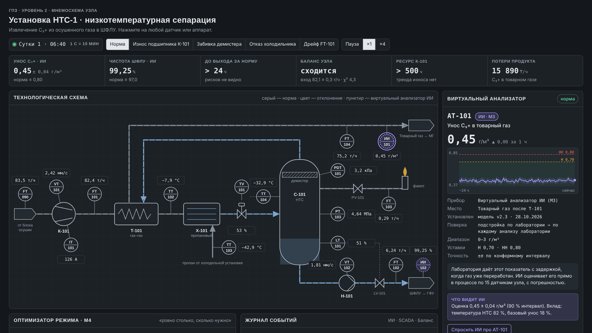
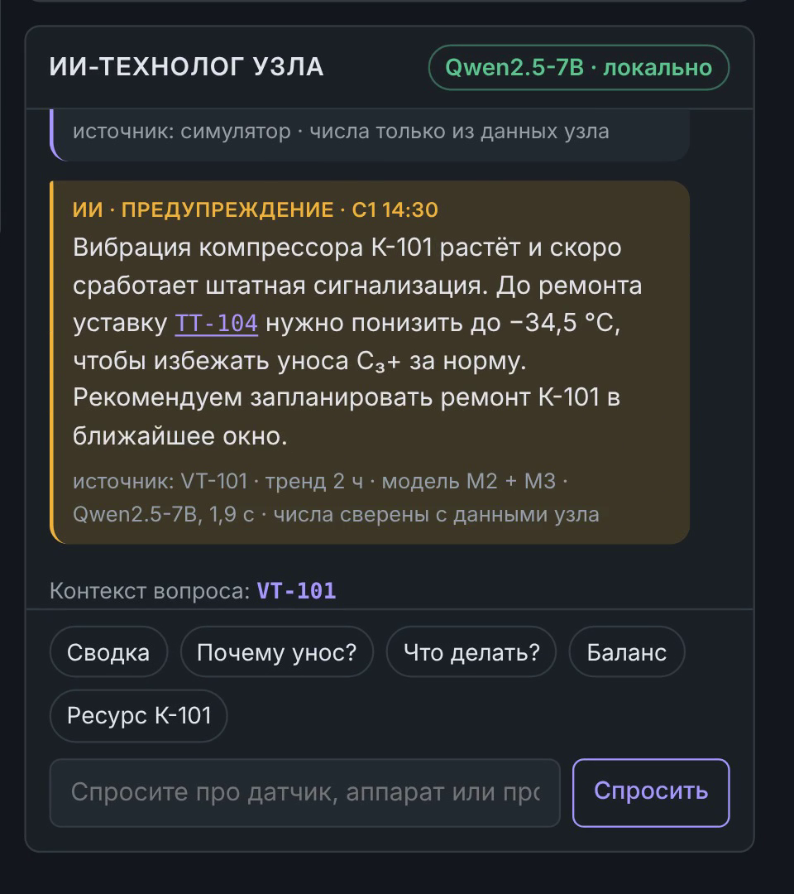

# AI-PromPlatform

**ИИ-надстройка над АСУ ТП для газо- и нефтеперерабатывающих заводов.**
Работает только на чтение поверх SCADA, локально, без интернета. Оператор видит не просто датчики, а качество продукта, состояние оборудования и честный баланс установки — и получает подсказку раньше, чем сработает штатная сигнализация.

Проект для конкурса **AISANA 2026** (МИТУ, трек 6.1.4).



---

## Какую задачу решаем

Завод видит датчики, но не видит продукт. Лабораторный анализ приходит с задержкой, когда сырьё уже переработано. Неисправный прибор и износ компрессора замечают, когда сработала сигнализация, — то есть поздно.

AI-PromPlatform связывает данные установки в одну картину и подсказывает оператору, что происходит и что делать. Решение всегда остаётся за человеком.

## Что умеет MVP

| Модуль | Что делает |
| --- | --- |
| **Ядро баланса** | Сводит все потоки установки в согласованный баланс и называет прибор, который врёт, и величину его ошибки |
| **Оборудование** | Видит износ компрессора по тренду вибрации раньше штатной уставки |
| **Качество** | ИИ-анализаторы оценивают качество продукта прямо в процессе, быстрее лаборатории, с указанием погрешности |
| **Режим** | Подбирает уставку, при которой продукт в норме с запасом, без переплаты за холод |
| **ИИ-технолог** | Локальная языковая модель объясняет ситуацию простыми словами и сама пишет при угрозе. Каждое число в ответе сверяется с данными узла |



**Принципы:** только чтение · всё локально · решение принимает человек · один движок для ГПЗ и НПЗ.

## Состав репозитория

```
demo/      Интерактивная мнемосхема установки НТС-1 + локальный сервер для ИИ-чата
proto/     Прототипы ядра: модель процесса, ИИ-анализаторы качества,
           баланс установки, планирование выпуска на АВТ, объяснение через LLM
docs/      Скриншоты
```

## Быстрый старт — демо мнемосхемы

Нужен только Python 3.10+ (сервер на стандартной библиотеке, ставить ничего не нужно).

1. Установите [Ollama](https://ollama.com) и загрузите модель:
   ```
   ollama pull qwen2.5:7b-instruct-q4_K_M
   ```
2. Запустите `demo/START_NTS.bat` (Windows) или:
   ```
   cd demo
   python server.py
   ```
3. Откроется браузер: http://127.0.0.1:8765. В чате должно быть написано «Qwen2.5-7B · локально».
4. Нажмите на любой датчик, задайте вопрос ИИ или запустите сценарий: «Износ подшипника К-101», «Дрейф FT-101».

Без Ollama страница тоже работает — ИИ отвечает шаблонами. Можно просто открыть `demo/nts_hmi.html` двойным кликом.

Модель и адрес Ollama меняются переменными окружения `AGPZ_LLM` и `AGPZ_OLLAMA`.

## Прототипы ядра

```
cd proto
pip install -r ../requirements.txt
python run_proto.py        # обучение ИИ-анализаторов качества и оценка упреждения
python reconcile_demo.py   # баланс установки и поиск неисправного расходомера
python refinery_plan.py    # планирование выпуска продуктов на установке АВТ
python run_llm.py          # связка ИИ-анализатор → локальная LLM (нужна Ollama)
```

Качество ИИ-анализаторов на модели процесса: R² от 0,81 до 0,99 по четырём показателям качества (`proto/models/quality_metrics.json`).

## Честно о статусе

- Это **MVP**. Все данные получены на физической модели процесса. **Данных реального завода в репозитории нет.**
- Решение **не внедрено** на производстве. Следующий шаг — пилот на одной установке, только чтение, без остановки производства.
- На реальных данных точность ожидаем ниже, чем на модели. Её подтвердит пилот.
- Мультиагентная схема (свой ИИ-агент у каждого отдела) и модуль для НПЗ — следующий этап, а не готовая часть MVP.

## Технологии

Python · NumPy · pandas · scikit-learn · XGBoost · SciPy · Ollama + Qwen2.5-7B (локально) · HTML/SVG/JS без фреймворков.

## Автор

Даниэль Искрин · AISANA 2026, МИТУ.

© 2026. Все права защищены. Код опубликован для ознакомления; использование и копирование — только с разрешения автора.
